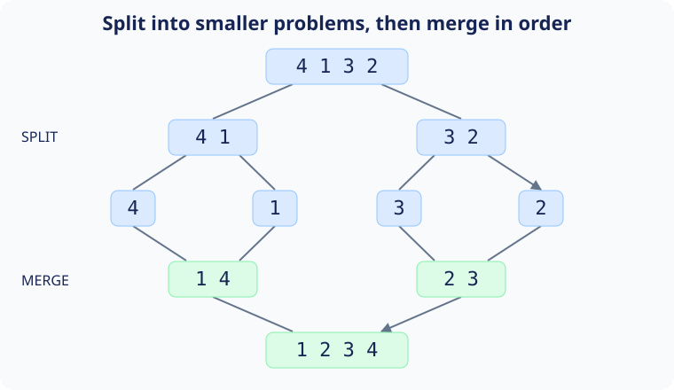


<script defer src="{{ '/assets/js/projects/sorting.js' | relative_url }}"></script>

I made these interactive sorting tools as a school project during my fourth year of high school.
I wanted to turn the algorithms we were studying into something I could watch: values moving across an array, one comparison or exchange at a time.

In this article, I'll use those tools to explain eight sorting algorithms, from bubble sort to merge sort.
We'll look at the idea behind each one, follow a small example, and connect what happens on screen to its computational cost.<d-cite key="sorting-overview"></d-cite>

## How to use the simulations

Each bar represents an array element: taller bars have larger values.
The goal is to arrange them in ascending order, from the shortest bar on the left to the tallest on the right.
Small arrays also display their values.
Every canvas has a gray-white background, with blue array bars, muted red active values, orange comparisons, and green settled positions.
The legend below each canvas identifies these colors.

I suggest starting with 16 or 32 elements and a delay of 100 milliseconds.
Click **Shuffle** to prepare an array, then **Sort** to run the animation.
Use **Pause** and **Resume** to inspect a step or continue from where you stopped.
Clicking **Shuffle** during a run stops it and resets its counter.
The **Array size** field controls how many values the next shuffle generates; **Step delay (ms)** controls the animation delay in milliseconds.
For a fresh comparison, choose the array size and click **Shuffle** before starting.

The counters describe different kinds of work.
Most demos count swaps; Shell sort counts array writes, including shifts and reinsertion; merge sort counts writes back into the array.
These are useful observations within one algorithm, but they are not interchangeable measures of runtime.
The animations also wait at different points, so their elapsed times are not benchmarks.

## What complexity tells us

We'll call the number of elements $$n$$.
Time complexity describes how an algorithm's work grows as $$n$$ increases, assuming comparisons, assignments, and swaps of individual values take constant time.
Auxiliary space counts additional working memory, including recursive calls, but excludes the input array.<d-cite key="complexity"></d-cite>


$$O(f(n))$$ gives an asymptotic upper bound; $$\Theta(f(n))$$ gives a tight growth bound.
A quadratic algorithm does roughly four times as much work when we double a large input.
An $$n\log n$$ algorithm grows more slowly: for example, $$n^2=1{,}048{,}576$$ and $$n\log_2 n=10{,}240$$ when $$n=1024$$.
These expressions illustrate growth, rather than exact operation counts.

The **best case** is the most favorable arrangement, the **worst case** is the least favorable, and the **average case** below assumes a uniformly random permutation of distinct values.
A **stable** sort preserves the relative order of equal keys.
For example, if two student records have the same grade, a stable sort by grade keeps them in their original order.

The table describes the C++ examples below.
Every sorting function takes a `std::vector<T>&` and sorts the half-open range `[start, end)`, including `start` and excluding `end`.
For example, with `std::vector<int> values = {4, 2, 3, 1};`, call `BubbleSort(values, 0, values.size())` to sort the entire vector in place.
Each example includes its required standard headers: `<vector>`, `<cstddef>` for `std::size_t`, and `<utility>` for `std::swap` where needed.
They assume `start <= end <= arr.size()` and values with consistent `<` and `>` comparisons.
Passing the vector by reference lets us modify it without copying the entire input; merge sort allocates a separate temporary vector when merging.

| Algorithm and variant | Best time | Average time | Worst time | Auxiliary space | Stable? |
| --- | --- | --- | --- | --- | --- |
| Bubble, fixed passes | $$\Theta(n^2)$$ | $$\Theta(n^2)$$ | $$\Theta(n^2)$$ | $$\Theta(1)$$ | Yes |
| Cocktail shaker, fixed passes | $$\Theta(n^2)$$ | $$\Theta(n^2)$$ | $$\Theta(n^2)$$ | $$\Theta(1)$$ | Yes |
| Insertion | $$\Theta(n)$$ | $$\Theta(n^2)$$ | $$\Theta(n^2)$$ | $$\Theta(1)$$ | Yes |
| Selection | $$\Theta(n^2)$$ | $$\Theta(n^2)$$ | $$\Theta(n^2)$$ | $$\Theta(1)$$ | No |
| Odd-even, full-cycle stopping | $$\Theta(n)$$ | $$\Theta(n^2)$$ | $$\Theta(n^2)$$ | $$\Theta(1)$$ | Yes |
| Shell, halved gaps | $$\Theta(n\log n)$$ | Gap- and input-dependent; $$O(n^2)$$ upper bound | $$\Theta(n^2)$$ | $$\Theta(1)$$ | No |
| Quick, last-element pivot | $$\Theta(n\log n)$$ | $$\Theta(n\log n)$$ | $$\Theta(n^2)$$ | $$\Theta(\log n)$$ balanced; $$\Theta(n)$$ worst | No |
| Merge, always merging | $$\Theta(n\log n)$$ | $$\Theta(n\log n)$$ | $$\Theta(n\log n)$$ | $$\Theta(n)$$ | Yes |

Implementation choices matter.
Adding early stopping changes bubble sort's best case; changing Shell sort's gaps changes its bounds.
Princeton's [sorting summary](https://algs4.cs.princeton.edu/cheatsheet/) is a useful reference for the standard algorithms, while these [sorting lecture notes](https://www.cs.wm.edu/~tadavis/cs303/ch07f.pdf) discuss the quadratic worst case of Shell's original gap sequence.

## Bubble sort

We'll start with adjacent pairs.
If the left value is larger, we swap the pair.
After one left-to-right pass, the largest value in the active range has reached its final position at the right edge.
Each new pass can therefore stop one element earlier.

For `[4, 2, 3, 1]`, the first pass produces `[2, 3, 1, 4]`.
The `4` is settled, even though the rest of the array still needs work.
In the animation, watch the sorted suffix grow from right to left.

This fixed-pass version performs the same number of comparisons for every arrangement:

$$
C(n)=(n-1)+(n-2)+\cdots+1=\frac{n(n-1)}{2}.
$$

Its time is therefore $$\Theta(n^2)$$, even on sorted input, although sorted input requires no swaps.
We could add a flag to stop after a swap-free pass and obtain a $$\Theta(n)$$ best case.
The version here deliberately keeps the fixed passes.
It uses constant auxiliary space and is stable because equal neighbors are never exchanged.



```cpp
#include <cstddef>
#include <vector>
#include <utility>

template <typename T>
void BubbleSort(std::vector<T>& arr, std::size_t start, std::size_t end) {
    for (std::size_t limit = end; limit > start; --limit) {
        for (std::size_t j = start; j + 1 < limit; ++j) {
            if (arr[j] > arr[j + 1])
                std::swap(arr[j], arr[j + 1]);
        }
    }
}
```

## Cocktail shaker sort

Cocktail shaker sort takes bubble sort in both directions.
We'll move the largest remaining value to the right with a forward pass, then move the smallest remaining value to the left with a backward pass.
After that round, both boundaries can move inward.

With `[2, 3, 4, 1]`, an ordinary forward bubble pass moves the `1` left by only one position.
A backward pass can carry it all the way to the beginning.
I suggest watching how small values travel left in this demo, rather than only following large values to the right.

The fixed-pass implementation below still scans a quadratic number of adjacent pairs, so its best, average, and worst times are all $$\Theta(n^2)$$.
Alternating direction changes the movement pattern without changing that growth rate.
As with bubble sort, a swap-free-pass check can make an optimized version linear on sorted input.
Strict adjacent comparisons keep this version stable, and its auxiliary space is $$\Theta(1)$$.



```cpp
#include <cstddef>
#include <vector>
#include <utility>

template <typename T>
void ShakerSort(std::vector<T>& arr, std::size_t start, std::size_t end) {
    if (end - start < 2) return;
    std::size_t left = start, right = end - 1;
    while (left < right) {
        for (std::size_t i = left; i < right; ++i)
            if (arr[i] > arr[i + 1])
                std::swap(arr[i], arr[i + 1]);
        --right;
        for (std::size_t i = right; i > left; --i)
            if (arr[i] < arr[i - 1])
                std::swap(arr[i], arr[i - 1]);
        ++left;
    }
}
```

## Insertion sort

Here we'll maintain a sorted prefix.
We take the next value and move it left until it reaches the correct position inside that prefix.
This is similar to inserting a new card into an already ordered hand.

For `[2, 4, 5, 3]`, the prefix `[2, 4, 5]` is sorted.
We exchange `3` with `5`, then with `4`, producing `[2, 3, 4, 5]`.
The animation makes this repeated movement through the prefix visible.

An **inversion** is a pair of indices $$i<j$$ with $$a_i>a_j$$.
Every adjacent swap in insertion sort removes exactly one inversion.
If the input has $$I$$ inversions, its running time is $$\Theta(n+I)$$.
Sorted input has none, giving a $$\Theta(n)$$ best case.
Reverse-sorted distinct input has the maximum:

$$
I_{\max}=\binom{n}{2}=\frac{n(n-1)}{2}.
$$

A uniformly random permutation has $$n(n-1)/4$$ inversions on average, so both average and worst time are $$\Theta(n^2)$$.
This also explains why insertion sort works well on nearly sorted data.
We need constant extra space, and equal values retain their order.



```cpp
#include <cstddef>
#include <vector>
#include <utility>

template <typename T>
void InsertionSort(std::vector<T>& arr, std::size_t start, std::size_t end) {
    if (end - start < 2) return;
    for (std::size_t i = start + 1; i < end; ++i) {
        std::size_t j = i;
        while (j > start && arr[j] < arr[j - 1]) {
            std::swap(arr[j], arr[j - 1]);
            --j;
        }
    }
}
```

## Selection sort

Instead of exchanging every out-of-order pair, we'll search the entire unsorted suffix for its minimum and swap that minimum into the next position.
The sorted prefix grows by one value per pass.

For `[4, 2, 3, 1]`, the first search finds `1` and exchanges it with `4`, giving `[1, 2, 3, 4]`.
Even though this particular array is now sorted, the remaining searches still run: selection sort does not use existing order to skip them.

The number of comparisons is again $$n(n-1)/2$$, giving $$\Theta(n^2)$$ time in all three cases.
The example skips self-swaps and makes at most $$n-1$$ actual swaps, using $$\Theta(1)$$ auxiliary space.
That separation between many comparisons and relatively few writes is its main distinction here.

Selection sort is not stable.
Label equal values to see why: sorting `[2A, 2B, 1]` begins by exchanging `2A` with `1`, leaving `[1, 2B, 2A]`.
The two equal keys have changed relative order.



```cpp
#include <cstddef>
#include <vector>
#include <utility>

template <typename T>
void SelectionSort(std::vector<T>& arr, std::size_t start, std::size_t end) {
    for (std::size_t i = start; i < end; ++i) {
        std::size_t minimum = i;
        for (std::size_t j = i + 1; j < end; ++j)
            if (arr[j] < arr[minimum]) minimum = j;
        if (minimum != i) std::swap(arr[i], arr[minimum]);
    }
}
```

## Odd-even sort

Odd-even sort, also called brick sort, alternates between two sets of adjacent pairs.
Using zero-based indices, one phase checks `(0, 1), (2, 3), …`; the other checks `(1, 2), (3, 4), …`.
Each pair is exchanged if it is out of order.

We'll repeat **both phases** until an entire two-phase cycle makes no swaps.
A single quiet phase is insufficient: `[1, 3, 2, 4]` needs no exchanges in the even-indexed pairs, but its middle pair is still reversed.
The C++ example below explicitly checks the full cycle.

Each cycle costs $$\Theta(n)$$; difficult inputs need a linear number of cycles, producing $$\Theta(n^2)$$ average and worst time.
Sorted input finishes after one full cycle, so the best case is $$\Theta(n)$$.
Strict adjacent swaps make it stable, and it needs $$\Theta(1)$$ extra space.

Pairs within one phase do not overlap, which makes the algorithm interesting for parallel execution.
This browser simulation runs sequentially; the bounds here describe sequential work.



```cpp
#include <cstddef>
#include <vector>
#include <utility>

template <typename T>
void OddEvenSort(std::vector<T>& arr, std::size_t start, std::size_t end) {
    if (end - start < 2) return;
    bool changed;
    do {
        changed = false;
        for (std::size_t phase = 0; phase < 2; ++phase) {
            for (std::size_t i = start + phase; i + 1 < end; i += 2) {
                if (arr[i] > arr[i + 1]) {
                    std::swap(arr[i], arr[i + 1]);
                    changed = true;
                }
            }
        }
    } while (changed);
}
```

## Shell sort

Shell sort extends insertion sort by comparing values several positions apart.
We'll first insertion-sort subsequences separated by a large **gap**, then reduce the gap and repeat.
The final gap of one is an ordinary insertion-sort pass, but earlier passes have already moved values closer to their destinations.

The gap sequence here is $$\lfloor n/2\rfloor,\lfloor n/4\rfloor,\ldots,1$$.
With eight elements, the gaps are `4, 2, 1`.
At gap four, indices `(0, 4)`, `(1, 5)`, `(2, 6)`, and `(3, 7)` form separate subsequences.
Watch how values can move across the array much earlier than in adjacent-swap insertion sort.

On sorted input, each gap pass still visits roughly $$n$$ values, and there are $$\Theta(\log n)$$ passes, giving $$\Theta(n\log n)$$ best time.
This halving sequence has a $$\Theta(n^2)$$ worst case.
I use a conservative $$O(n^2)$$ upper bound for its average time rather than assigning Shell sort a universal average-case exponent: the gap sequence is part of the algorithm's analysis.

The implementation uses $$\Theta(1)$$ auxiliary space.
It is not stable because long-distance movements can carry equal keys past one another.
Its counter includes reinserting the saved value as well as shifting preceding values, so it measures array writes rather than swaps.



```cpp
#include <cstddef>
#include <vector>

template <typename T>
void ShellSort(std::vector<T>& arr, std::size_t start, std::size_t end) {
    for (std::size_t gap = (end - start) / 2; gap > 0; gap /= 2) {
        for (std::size_t i = start + gap; i < end; ++i) {
            T value = arr[i];
            std::size_t j = i;
            while (j - start >= gap && arr[j - gap] > value) {
                arr[j] = arr[j - gap];
                j -= gap;
            }
            arr[j] = value;
        }
    }
}
```

## Quicksort

Quicksort partitions an array around a **pivot**, then recursively sorts the two sides.<d-cite key="quicksort"></d-cite>
In this version, we'll choose the last value as the pivot, collect values less than or equal to it on the left, and finally place the pivot between the partitions.
The pivot is then in its final sorted position.

For `[4, 1, 3, 2]`, the pivot is `2`.
Partitioning produces `[1, 2, 3, 4]`, with `2` settled.
In general, the two sides still need recursive sorting; partitioning does not sort them internally.

When partitions are balanced, each recursion level does $$\Theta(n)$$ work across its subarrays, and there are $$\Theta(\log n)$$ levels:

$$
T(n)=2T(n/2)+\Theta(n)=\Theta(n\log n).
$$

The average time for uniformly random distinct input is also $$\Theta(n\log n)$$.
However, choosing the last element gives extremely uneven partitions on already sorted, reverse-sorted, or all-equal input:

$$
T(n)=T(n-1)+\Theta(n)=\Theta(n^2).
$$

I suggest comparing the balanced and unbalanced recurrences: quicksort's performance depends on the shape of its recursion tree.
Randomizing pivot selection helps avoid predictable bad inputs, while three-way partitioning handles repeated keys more effectively.

Partitioning uses constant working space, but recursive calls need $$\Theta(\log n)$$ space for balanced partitions and $$\Theta(n)$$ in the worst case.
This implementation is not stable.
Its half-open ranges also avoid subtracting one from a zero-valued unsigned pivot index.



```cpp
#include <cstddef>
#include <vector>
#include <utility>

template <typename T>
std::size_t Partition(std::vector<T>& arr, std::size_t start, std::size_t end) {
    T pivot = arr[end - 1];
    std::size_t boundary = start;
    for (std::size_t j = start; j < end - 1; ++j) {
        if (!(pivot < arr[j])) { // arr[j] <= pivot
            std::swap(arr[boundary], arr[j]);
            ++boundary;
        }
    }
    std::swap(arr[boundary], arr[end - 1]);
    return boundary;
}

template <typename T>
void QuickSort(std::vector<T>& arr, std::size_t start, std::size_t end) {
    if (end - start < 2) return;
    std::size_t pivot = Partition(arr, start, end);
    QuickSort(arr, start, pivot);
    QuickSort(arr, pivot + 1, end);
}
```

## Merge sort

Merge sort also divides the problem, but its split is always near the middle.<d-cite key="merge-sort"></d-cite>
We'll recursively sort the two halves, then merge them by repeatedly taking the smaller of their first unconsumed values.
A one-element range is already sorted.

For `[4, 1, 3, 2]`, we split into `[4, 1]` and `[3, 2]`, sort those into `[1, 4]` and `[2, 3]`, then merge them into `[1, 2, 3, 4]`.



Merging two halves with a total of $$n$$ elements takes $$\Theta(n)$$ work.
Balanced splitting gives the same recurrence as balanced quicksort:

$$
T(n)=T(\lfloor n/2\rfloor)+T(\lceil n/2\rceil)+\Theta(n)
     =\Theta(n\log n).
$$

The difference is the guarantee: these splits stay balanced for every input.
This version always merges, so best, average, and worst time are all $$\Theta(n\log n)$$.
We could optimize it by checking whether the halves already meet in order, but that check is not included here.

The temporary buffer requires $$\Theta(n)$$ auxiliary space at peak; the $$\Theta(\log n)$$ recursion stack does not change that overall bound.
We take from the left half when keys are equal, preserving stability.
I use a `std::vector` for the temporary values so their lifetimes are managed correctly in C++.
In the demo, the counter tracks writes back into the main array, not exchanges between two positions.



```cpp
#include <cstddef>
#include <vector>

template <typename T>
void Merge(std::vector<T>& arr, std::size_t start, std::size_t middle, std::size_t end) {
    std::vector<T> buffer(arr.begin() + start, arr.begin() + end);
    const std::size_t leftEnd = middle - start;
    std::size_t i = 0, j = leftEnd, k = start;
    while (i < leftEnd && j < buffer.size()) {
        // Choose the left value on equal keys to preserve stability.
        if (!(buffer[j] < buffer[i])) arr[k++] = buffer[i++];
        else arr[k++] = buffer[j++];
    }
    while (i < leftEnd) arr[k++] = buffer[i++];
    while (j < buffer.size()) arr[k++] = buffer[j++];
}

template <typename T>
void MergeSort(std::vector<T>& arr, std::size_t start, std::size_t end) {
    if (end - start < 2) return;
    std::size_t middle = start + (end - start) / 2;
    MergeSort(arr, start, middle);
    MergeSort(arr, middle, end);
    Merge(arr, start, middle, end);
}
```

## What I suggest comparing

Start with bubble sort and selection sort on arrays of the same size.
Their comparison counts grow quadratically, but selection sort makes far fewer swaps.
Next, compare insertion sort with Shell sort and watch the difference between adjacent movement and movement across a gap.
Finally, run quicksort and merge sort on larger arrays to see partitioning and merging produce two different visual patterns.

The shuffle controls generate distinct values rather than custom inputs, so the demos do not directly expose every best or worst case.
To observe sorted input, finish a run and click **Sort** again without shuffling.
To explore those cases, I suggest running the C++ examples on sorted, reverse-sorted, and duplicate-heavy arrays.
To investigate stability, use records with a key and an identity, and compare only the key.

All eight methods here are comparison sorts.
A comparison can distinguish at most two outcomes for distinct keys, and a correct sort must distinguish among $$n!$$ possible input orders.
A decision tree therefore needs worst-case height at least

$$
\lceil\log_2(n!)\rceil=\Omega(n\log n).
$$

That lower bound explains why merge sort's worst-case growth is optimal in this model.
It does not apply to every possible sorting method: algorithms such as counting sort use extra assumptions about the keys.
Princeton's [introduction to sorting](https://algs4.cs.princeton.edu/20sorting/) provides a path into these broader topics.

For me, the value of this school project is the connection between the code and its behavior.
We can watch where values move, identify the invariant each pass maintains, and then explain why the amount of work grows the way it does.