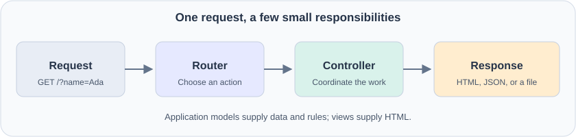
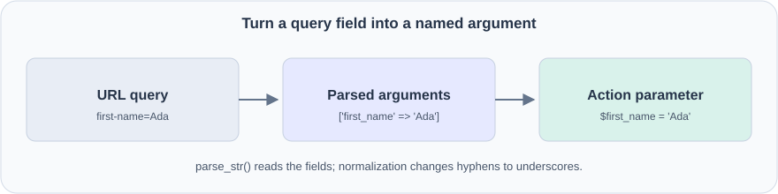
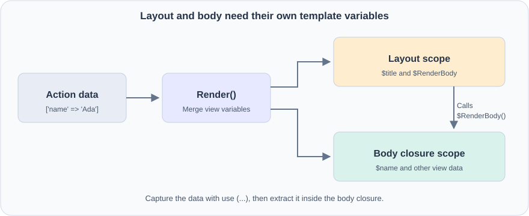

> <span class="sr-only">Information: </span>
>
> The repo with the following code is avaible on [GitHub](https://github.com/Richie314/Php-Simple-MVC).
{: .block-info }

A PHP application can begin with a single page. As soon as we add another page, a form, and a shared header, that simple file starts doing several jobs at once. Building a small library gives each job a home and makes the next page easier to write.

Let's build toward Simple MVC using PHP 8.3 or newer. We'll start with a response, introduce one feature at a time, and finish with automated tests and releases. You only need basic PHP: variables, arrays, functions, and a little HTML. Classes and other unfamiliar syntax will be explained as they appear.

The early code examples are small building blocks, not complete replacements for the library files. Each section explains what to add or change. The final application example uses the finished library's API.



## 1. Give every request one starting point

Our first page needs very little:

```php
<?php
// demo/index.php
header('Content-Type: text/plain; charset=UTF-8');
echo 'Hello, world!';
```

`header()` tells the browser what kind of response it is receiving. `echo` writes its body. Headers must be sent before output, so the file begins with `<?php`, without a blank line before it.

We could create a separate PHP file for every page. Instead, we'll keep `index.php` as the entry point and let it choose what to run. This pattern is called a **front controller**: every application request enters through the same door.

For local development, PHP has a built-in server. From the project directory, run:

```bash
php -S localhost:8000 -t demo demo/index.php
```

Here, `demo` is the public document directory, and `demo/index.php` is the development router script. Visit `http://localhost:8000/`. The built-in server is for development; a production server needs its own front-controller configuration.

## 2. Let Composer find our classes

As we move code into separate files, manually writing `require` for every class becomes repetitive. Composer can load classes when PHP first uses them.

We give the library this directory structure:

```text
project/
  composer.json
  src/
    Controllers/
    Controllers/Attributes/
    Http/
    Routers/
    Users/
    Utils/
  demo/
    index.php
    Views/
      Home/
      Shared/
```

The relevant part of `composer.json` is:

```json
{
  "name": "richie314/simple-mvc",
  "require": {
    "php": ">=8.3"
  },
  "autoload": {
    "psr-4": {
      "Richie314\\SimpleMvc\\": "src/"
    }
  },
  "autoload-dev": {
    "psr-4": {
      "Richie314\\SimpleMvc\\Demo\\": "demo/"
    }
  }
}
```

A **namespace** gives a class a full name, avoiding clashes with similarly named classes in other packages. The PSR-4 mapping says that `Richie314\SimpleMvc\Controllers\Controller` belongs in `src/Controllers/Controller.php`. The double backslashes above are how JSON represents a literal backslash.

Run `composer install`, then add this to the entry point:

```php
require dirname(__DIR__) . '/vendor/autoload.php';
```

`__DIR__` is the directory containing the current PHP file. Since `index.php` lives in `demo`, `dirname(__DIR__)` takes us to the project root.

The development mapping loads our example classes from a checkout. Applications installing the package through Composer configure their own application-class autoloading.

## 3. Give HTTP values readable names

A successful page usually has status `200`. A missing page uses `404`. Numbers work, but names communicate intent more clearly.

Add an enum in `src/Http/StatusCode.php`:

```php
<?php
namespace Richie314\SimpleMvc\Http;

enum StatusCode: int
{
    case Ok = 200;
    case Created = 201;
    case SeeOther = 303;
    case BadRequest = 400;
    case NotAuthorized = 401;
    case NotFound = 404;
    case ServerError = 500;
}
```

An **enum** is a defined set of named values. This is a shortened selection of the finished library's cases. `StatusCode::Ok` is an enum value; `StatusCode::Ok->value` is the integer `200` needed by PHP's HTTP functions.

Add the same idea for request methods:

```php
<?php
namespace Richie314\SimpleMvc\Http;

enum Method: string
{
    case Get = 'GET';
    case Post = 'POST';
    case Put = 'PUT';
    case Patch = 'PATCH';
    case Delete = 'DELETE';
    case Head = 'HEAD';
    case Options = 'OPTIONS';
    case Trace = 'TRACE';
}
```

`GET` commonly retrieves a page. `POST` commonly submits a form. We can convert the server's request method into the enum with:

```php
$method = Method::from(strtoupper($_SERVER['REQUEST_METHOD']));
```

`from()` rejects values outside the enum. Having a method case does not yet give us body parsing or routing rules for that method; those are separate decisions.

## 4. Move response-writing into a base controller

Our entry point should choose a page rather than build every response itself. Introduce a **controller**, a class whose public methods handle requests. We'll call those methods **actions**.

A shared base class can provide the response-writing code:

```php
<?php
namespace Richie314\SimpleMvc\Controllers;

use Richie314\SimpleMvc\Http\StatusCode;

class Controller
{
    protected function Content(
        string $type,
        string $content,
        StatusCode|int $statusCode = StatusCode::Ok,
    ): StatusCode {
        if (!$statusCode instanceof StatusCode) {
            $statusCode = StatusCode::from($statusCode);
        }

        http_response_code($statusCode->value);
        header("Content-Type: $type");
        header('Content-Length: ' . strlen($content));
        echo $content;

        return $statusCode;
    }
}
```

`protected` means the helper is available inside this class and its child classes. It is not intended to become a public action. The `StatusCode|int` type accepts either an enum case or an integer, while the return type promises an enum.

An application controller can now extend the base class:

```php
<?php
// demo/HomeController.php
namespace Richie314\SimpleMvc\Demo;

use Richie314\SimpleMvc\Controllers\Controller;
use Richie314\SimpleMvc\Http\StatusCode;

class HomeController extends Controller
{
    public function index(): StatusCode
    {
        return $this->Content('text/plain; charset=UTF-8', 'Hello, world!');
    }
}
```

`extends` makes the shared helpers available through `$this`, the current object. `return` passes the helper's result back to whoever called the action.

The response has two effects: it sends content to the browser and returns a status for our PHP code to inspect. Merely returning an enum does not send an HTTP status; the response helper does that work.

## 5. Map URLs to actions

We now need to turn a path such as `/hello` into a controller and method. Add a `Router` class in `src/Routers/Router.php`.

Its first job is to store a route table:

```php
private array $routes = [];

public function AddRouteAction(
    string $route,
    string $controller,
    string $action,
): void {
    $this->routes[$route] = [
        'controller' => $controller,
        'action' => $action,
    ];
}
```

A route is just a lookup entry. This registration says, “For `/hello`, create `HomeController` and run `index`”:

```php
$router->AddRouteAction('/hello', HomeController::class, 'index');
```

`::class` returns the full class name as a string. It does not create an object.

Next, add dispatching. The important operations are:

```php
$path = parse_url($uri, PHP_URL_PATH);
$route = $this->routes[$path];
$controllerClass = $route['controller'];
$action = $route['action'];

$controller = new $controllerClass(
    requestPath: $uri,
    requestMethod: $this->RequestMethod,
);

return $controller->$action();
```

This fragment assumes the router has read the request method, the base controller has gained matching constructor parameters, and the route exists. We'll add missing-route handling shortly.

The syntax `requestPath: $uri` is a **named argument**. PHP matches the value to a parameter by name instead of position.

The path and query string are different parts of the URL: `/hello?name=Ada` has path `/hello`. Extracting the path lets the same route handle different query values. Routes match exactly; `/hello` and `/hello/` remain different routes.

## 6. Pass query parameters to actions

A fixed greeting is a useful start. A personalized greeting is more interesting. Change the action to accept a parameter:

```php
public function index(string $first_name = 'World'): StatusCode
{
    return $this->Content(
        'text/plain; charset=UTF-8',
        'Hello, ' . $first_name . '!',
    );
}
```

The default value means a visitor can omit the name. In the router, parse the query and normalize field names:

```php
$query = parse_url($uri, PHP_URL_QUERY);
$parameters = [];

if (is_string($query) && $query !== '') {
    parse_str($query, $parameters);
}

$named = [];
foreach ($parameters as $name => $value) {
    $named[str_replace('-', '_', $name)] = $value;
}
```

Replace the direct method call with:

```php
return call_user_func_array([$controller, $action], $named);
```

With string array keys, PHP passes these as named arguments. `/hello?first-name=Ada` becomes `$first_name = 'Ada'` in the action.



This convenience makes parameter names part of the action's interface. Extra fields, missing required arguments, or array values where strings are expected can cause invocation errors. Type declarations help describe inputs, but application code still needs to validate what those inputs mean.

## 7. Add form submissions

A browser form normally sends its fields through `POST`:

```html
<form method="post" action="/hello">
  <label>Name <input name="first-name" required></label>
  <button type="submit">Say hello</button>
</form>
```

Extend the router's parameter parser so it selects the input source first:

```php
switch ($this->RequestMethod) {
    case Method::Get:
        // Parse the query string as in the previous section.
        break;
    case Method::Post:
        $parameters = $_POST;
        break;
}
```

Then apply the same hyphen-to-underscore conversion. Both request types can call the same action without copying the binding code.

Before using a submitted name, the action can trim it and reject an empty result:

```php
$first_name = trim($first_name);
if ($first_name === '') {
    return $this->BadRequest('Please enter a name.');
}
```

We'll add the `BadRequest()` helper in the error-handling step. The HTML `required` attribute helps the browser's user, but the server still checks the input because requests can arrive without that browser validation.

The library does not automatically decode JSON request bodies or bind parameters for other methods. Route registration also does not restrict which HTTP method may call an action. An action that changes data should check `$this->RequestMethod` and apply the application's authentication and CSRF protection rules.

## 8. Move HTML into a view

A controller becomes hard to read if it contains a large HTML string. Move the markup to `demo/Views/Home/index.php`:

```php
<h1>Hello, <?= htmlspecialchars($name, ENT_QUOTES, 'UTF-8') ?>!</h1>
```

A **view** is a template responsible for presentation. `<?= ... ?>` is the short form of `<?php echo ...; ?>`.

Notice the escaping. If someone enters `<strong>Ada</strong>`, we want to display those characters as a name, rather than let them inject markup. `htmlspecialchars()` performs HTML escaping at the point of output.

Change the action to describe what to render:

```php
public function index(string $name = 'World'): StatusCode
{
    return $this->Render('Home/index', ['name' => $name], 'Welcome');
}
```

Add view lookup to the base controller. It combines a trusted application directory with `Views/` and the view name. For a name without a dot, the finished library tries `.php`, `.html`, and `.htm`, then tries the shared-view directory.

The first rendering idea is simply:

```php
$view_file = $this->ViewFileName($view);
extract($data, EXTR_SKIP);
require $view_file;
```

`extract()` turns `['name' => 'Ada']` into a local `$name` variable. `EXTR_SKIP` prevents those values from overwriting existing local variables. We pass an explicitly constructed data array, never an entire request array, and the view name comes from application code rather than visitor input.

This fragment shows the core operation. A usable `Render()` also checks for a missing file, sends a status, and returns that status.

## 9. Add a shared layout without losing view variables

The next page needs the same document structure and header. Instead of copying them, introduce `demo/Views/Shared/Layout.php`:

```php
<!doctype html>
<html lang="en">
<head>
  <meta charset="UTF-8">
  <title><?= htmlspecialchars($title, ENT_QUOTES, 'UTF-8') ?></title>
</head>
<body>
  <header>A tiny PHP application</header>
  <main><?php $RenderBody(); ?></main>
</body>
</html>
```

`$RenderBody` is a function stored in a variable. The layout chooses where to call it, and that call includes the page's view.

Update the rendering code to prepare variables for both places:

```php
$view_variables = array_merge($data, $this->ViewBag, [
    'title' => $title,
    'status_code' => $statusCode->value,
    'user' => $this->User,
    'P' => $this->PathPrefix,
]);

$view_variables['RenderBody'] = function () use ($view_file, $view_variables): void {
    extract($view_variables, EXTR_SKIP);
    require $view_file;
};

extract($view_variables, EXTR_SKIP);
require $layout_file_path;
```

A function has its own variable scope. The `use (...)` clause explicitly brings the selected file and data into this **closure**, a function created inside another piece of code. Without extracting inside the closure, the body would not receive `$name`, even though the layout could receive it.



`array_merge()` gives later string keys priority. The order above means default view variables override action data, and built-in variables such as `$title` override both. Internal renderer variable names are reserved.

Use `require` for templates, not `require_once`: each render should produce its output, even if the same layout was already rendered earlier in the request.

To share a site name across controllers, add a router method that stores defaults and passes them into each controller's constructor:

```php
$router->SetDefaultVariable('siteName', 'My application');
```

The controller stores these in `$this->ViewBag`. The layout can then escape and display `$siteName` just like any other view variable.

## 10. Give application data a separate home

We now have a controller and a view. Where does the **model** fit?

The model is the application's data and the rules around that data. It does not have to be a database table or extend a framework class. Start with a tiny greeting rule in `demo/Greeting.php`:

```php
<?php
namespace Richie314\SimpleMvc\Demo;

class Greeting
{
    public static function ForName(string $name): string
    {
        $name = trim($name);
        return 'Hello, ' . ($name === '' ? 'World' : $name) . '!';
    }
}
```

`static` lets us call this method on the class itself. Edit the controller action:

```php
public function index(string $name = 'World'): StatusCode
{
    return $this->Render(
        'Home/index',
        ['message' => Greeting::ForName($name)],
        'Welcome',
    );
}
```

Replace the view's heading to match the new data key:

```php
<h1><?= htmlspecialchars($message, ENT_QUOTES, 'UTF-8') ?></h1>
```

The model builds the message, the controller coordinates the request, and the view renders HTML. The model does not escape HTML because another caller might want the same message as plain text or JSON.

Later, models may read a database. The library can share an optional `mysqli` connection through `Router::SetDbConnection()`, making it available as `$this->DB` in controllers. Actual queries and application rules remain the application's responsibility. No database is required for the greeting example.

## 11. Register a whole controller

After adding several actions, repeated registrations become tedious. Add `AddController()` to discover public methods and register each beneath a base path:

```php
$router->AddController(HomeController::class, '/');
```

The implementation inspects public method names, skips names beginning with `_` or `#`, and maps the base path to `index()`.

The mapping becomes:

| URL | Action |
| --- | --- |
| `/` | `HomeController::index()` |
| `/index` | `HomeController::index()` |
| `/hello` | `HomeController::hello()` if that public method exists |

Keep internal helpers protected or private. If an application needs to expose only selected actions, explicit `AddRouteAction()` registrations remain the clearer choice. Existing routes still work; the convenience method only saves repetitive setup.

## 12. Support installation beneath a URL prefix

The application may live at `https://example.com/myapp/` rather than the domain root. Add a prefix to the router:

```php
$router = new Router(
    pathPrefix: '/myapp',
    applicationInstallationPath: __DIR__,
);
```

The prefix is a URL path. The installation path is a filesystem directory. They solve different problems and should not be confused.

Change route registration to prepend the prefix:

```php
$this->routes[$this->PathPrefix . $route] = [
    'controller' => $controller,
    'action' => $action,
];
```

Keep registering routes such as `/hello`, not `/myapp/hello`. The router now supplies the prefix. In views, `$P` provides that same value for links:

```php
<a href="<?= htmlspecialchars($P, ENT_QUOTES, 'UTF-8') ?>/hello">Hello</a>
```

An empty prefix keeps root installations working. Avoid an extra trailing slash in a configured prefix, because concatenation is literal.

## 13. Return useful error responses

A visitor will eventually request a missing page. Check the route table before accessing it. Select `ErrorController::NotFoundHandler()` when the path is absent, and clear the action arguments for that fallback.

Why clear them? `/missing?unexpected=value` should remain a 404. Passing `unexpected` into a zero-argument error handler would create another error.

Add helpers to the base controller for `NotFound()`, `BadRequest()`, `NotAuthorized()`, and `InternalError()`. Each sets the corresponding status and uses `Views/Shared/Error.php` when present. A missing error view should produce plain text with the intended status, not another missing-view error.

A small error view could be:

```php
<h1>We could not complete that request</h1>
<p><?= htmlspecialchars($main_banner, ENT_QUOTES, 'UTF-8') ?></p>
```

Finally, put controller construction, action filters, and action invocation inside the router's `try` block:

```php
try {
    // Create the controller, run its attributes, and call the action.
} catch (\Throwable $ex) {
    if (headers_sent()) {
        throw $ex;
    }

    // Create ErrorController and return InternalErrorHandler($ex).
}
```

`Throwable` covers exceptions and PHP errors. Before output starts, the router can send a server-error response. After headers have been sent, it cannot reliably replace the response, so it rethrows the problem.

The current error helper uses an exception's message as its banner. Applications serving public traffic should arrange error handling so private exception details are logged rather than displayed to visitors.

## 14. Add JSON responses

An action may serve JavaScript or another application instead of an HTML page. Add a `Json()` helper that encodes a value and delegates to `Content()`:

```php
public function hello(string $name = 'World'): StatusCode
{
    return $this->Json(['message' => Greeting::ForName($name)]);
}
```

The essential encoding call is:

```php
$content = json_encode($object, JSON_THROW_ON_ERROR);
return $this->Content('application/json', $content, $statusCode);
```

`JSON_THROW_ON_ERROR` turns an encoding failure into a `JsonException`, which the router can handle. We avoid silently returning an empty or misleading response.

To allow extra JSON flags, add a separate helper:

```php
return $this->JsonWithOptions(
    ['url' => '/hello'],
    flags: JSON_UNESCAPED_SLASHES,
);
```

Keeping `Json()`'s signature unchanged matters for existing applications that override it in a child controller. Adding an optional argument to a parent method can still make an older override incompatible. A new helper provides the extra behavior without changing that contract.

## 15. Redirect after a successful form submission

After a form saves data, sending the browser to a different page avoids displaying the result of the submission directly. Add an explicit-status redirect helper:

```php
return $this->RedirectWithStatus('/saved', StatusCode::SeeOther);
```

The core implementation is:

```php
header("Location: $url", response_code: $statusCode->value);
return $statusCode;
```

A `303 See Other` tells the browser to follow the destination using `GET`. The application must also register the destination route.

A response helper does not automatically stop PHP. Returning it from the action ensures the action ends at that point. Do not take the destination directly from untrusted input without checking it.

The existing `Redirect()` API is preserved: it returns the 301 enum even though PHP normally sends 302 for its bare Location header. New code can use `RedirectWithStatus()` when the returned value and actual response must agree.

## 16. Run a login check before an action

Repeating a login check inside every protected action is easy to forget. Introduce a small interface for code that runs before an action:

```php
<?php
namespace Richie314\SimpleMvc\Controllers\Attributes;

use Richie314\SimpleMvc\Controllers\Controller;

interface Attribute
{
    public function DoWork(
        Controller $controller,
        string $action,
        array $parameters,
    ): void;
}
```

An **interface** describes what a class must provide. Here, a filter must implement `DoWork()`.

The built-in `RequireLogin` class implements that interface and is marked with PHP's `#[\Attribute]`. That marker permits using it as metadata above an action:

```php
#[\Richie314\SimpleMvc\Controllers\Attributes\RequireLogin(loginPath: '/login')]
public function account(): StatusCode
{
    return $this->Json(['name' => $this->User->Name]);
}
```

In the router, use reflection to discover and run those objects before invoking the action:

```php
$attributes = (new \ReflectionMethod($controllerClass, $action))
    ->getAttributes(
        \Richie314\SimpleMvc\Controllers\Attributes\Attribute::class,
        \ReflectionAttribute::IS_INSTANCEOF,
    );

foreach ($attributes as $attribute) {
    $attribute->newInstance()->DoWork($controller, $action, $named);
}
```

**Reflection** lets PHP inspect a class or method while the program is running. The filter interface prevents the router from treating unrelated metadata as an action filter.

The application loads an authenticated `User` and passes it to `$router->SetUser($user)`. `RequireLogin` checks whether that user exists. If absent, it records the requested URI in a cookie, redirects to login, and terminates the request. With `requireAdmin: true`, it additionally checks the user's `Admin` flag.

The attribute enforces access; it does not implement account registration, sessions, or password persistence. The application supplies those pieces and a login action. Only call `SetUser()` with identity information established by the application's authentication process.

## 17. Add cookie options without changing existing calls

The login redirect introduces a browser cookie. A helper keeps the expiration calculation in one place:

```php
use Richie314\SimpleMvc\Utils\Cookie;

Cookie::Set('preference', 'compact', 3600);
```

`3600` is a lifetime in seconds, not an absolute timestamp. Internally, the helper adds it to `time()`.

For configurable security attributes, add `SetWithOptions()`:

```php
Cookie::SetWithOptions(
    'preference',
    'compact',
    3600,
    path: '/myapp',
    secure: true,
    sameSite: 'Lax',
);
```

`secure` restricts transmission to HTTPS. HTTP-only cookies are the default, preventing browser scripts from reading them. SameSite influences when a browser includes the cookie in requests coming from another site; it is not a replacement for an application's CSRF protection.

Keep the original method and defaults intact. As with JSON options, the separate method also preserves existing subclass signatures.

Cookie reads come from the incoming request:

```php
$value = Cookie::Get('preference'); // null when absent
Cookie::DeleteWithOptions('preference', path: '/myapp');
```

Writing a response cookie does not rewrite `$_COOKIE`. Deletion sends an expired cookie and must match the original path and domain. Cookies, like other headers, must be written before output.

## 18. Add a password helper

Passwords should be verified against stored hashes, not stored as readable text. Wrap PHP's password functions:

```php
use Richie314\SimpleMvc\Utils\Security;

$hash = Security::Hash('a long example password');
$matches = Security::TestPassword('a long example password', $hash);
```

The library uses `password_hash()` with bcrypt and `password_verify()`. Verification does not require decrypting anything. The stored hash contains the information PHP needs for comparison.

The helper marks plaintext password parameters with `#[\SensitiveParameter]`, which redacts their values from stack traces. This does not stop application code from logging a password directly, so keep it out of logs.

For compatibility, hashing an empty string returns an empty string, and verification with an empty password or hash returns false. Application validation should reject empty passwords before storage. Password-length and storage policies belong to the application too.

## 19. Read configuration from environment-backed files

A deployment may provide a setting directly or place it in a secret file. Add a helper with a predictable precedence:

```php
$password = Security::LoadEnvironmentOrFromFile('DB_PASSWORD', 'fallback');
```

It first checks `$_ENV['DB_PASSWORD']`. If absent, it looks for a filename in `$_ENV['DB_PASSWORD_FILE']` and reads that file. If neither provides a value, it returns the fallback.

The important condition is:

```php
$content = file_get_contents($filename);
if ($content === false) {
    return $default;
}
return $content;
```

Use `=== false`, not `if (!$content)`. An empty file and a file containing `0` are both readable files with valid contents. A strict comparison distinguishes those values from a failed read.

The helper uses `$_ENV`, not `getenv()`, and preserves file contents, including trailing newlines. The application's environment setup needs to populate the expected keys.

## 20. Serve a file and normalize uploads

A download action should not duplicate MIME detection and attachment headers. The controller's file helper can supply them:

```php
public function download(): StatusCode
{
    return $this->File(__DIR__ . '/Private/report.pdf');
}
```

The application must create that file and apply any required access checks. Use a trusted path; do not append arbitrary visitor input to a private directory path.

`File()` checks for a missing path, detects its MIME type, optionally adds attachment headers, and sends the content. It loads the whole file into memory, so it is suitable for modest downloads rather than a general large-file streaming solution.

For uploads, the utility class normalizes PHP's different single-file and multiple-file structures:

```php
use Richie314\SimpleMvc\Utils\File;

foreach (File::UploadingFiles('attachments') as $upload) {
    if ($upload['error'] !== UPLOAD_ERR_OK) {
        continue;
    }
    // Apply the application's size/type rules, then move_uploaded_file().
}
```

The matching form needs `enctype="multipart/form-data"` and a field such as `<input type="file" name="attachments[]" multiple>`.

Normalization makes iteration easier. It does not validate a file or make its original name trustworthy. The application chooses safe storage names and validates the content before accepting it.

## 21. Document the public contract

At this point, method names alone do not explain enough. Add PHPDoc above functions so editors can show meaningful help:

```php
/**
 * Set or replace a default variable for controller views.
 *
 * @param string $key Variable name; an empty name is ignored.
 * @param mixed $value Value passed through the controller ViewBag.
 * @return void
 */
public function SetDefaultVariable(string $key, mixed $value): void
{
    if ($key === '') {
        return;
    }
    $this->defaultViewBag[$key] = $value;
}
```

Describe behavior as well as types. A useful cookie comment explains whether expiration is relative, whether the incoming cookie array changes, and what deletion requires. Array documentation can describe entry types, for example `array<string, mixed>` for view data.

Names used as named arguments are also part of the contract. Even a spelling correction can break a caller using that parameter name. The finished renderer therefore preserves the existing `cutomLayout` spelling.


## Put the pieces together

The application entry point is now small because the library has taken over the repeated work. With the finished library, the `Greeting` model, the final `HomeController::index()` action, and the message view from step 10, `demo/index.php` can be:

```php
<?php
require dirname(__DIR__) . '/vendor/autoload.php';

use Richie314\SimpleMvc\Demo\HomeController;
use Richie314\SimpleMvc\Routers\Router;

$router = new Router(applicationInstallationPath: __DIR__);
$router->AddController(HomeController::class, '/');
$router->Dispatch($_SERVER['REQUEST_URI']);
```

After generating the development autoloader, start the local server:

```bash
composer install
php -S localhost:8000 -t demo demo/index.php
```

Visit `http://localhost:8000/?name=Ada`. The router selects `index()`, binds the name, and creates the controller. The action asks the model for a greeting and passes it to the view. The renderer places the view inside the layout and sends the response.

Try changing the name, omitting it, and requesting `/missing`. Then run the Docker checks before making the next change. Each feature now has a clear place: routing selects an action, the controller coordinates it, models hold application rules, and views present the result.
