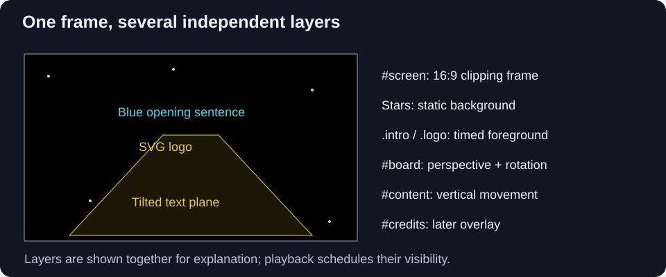
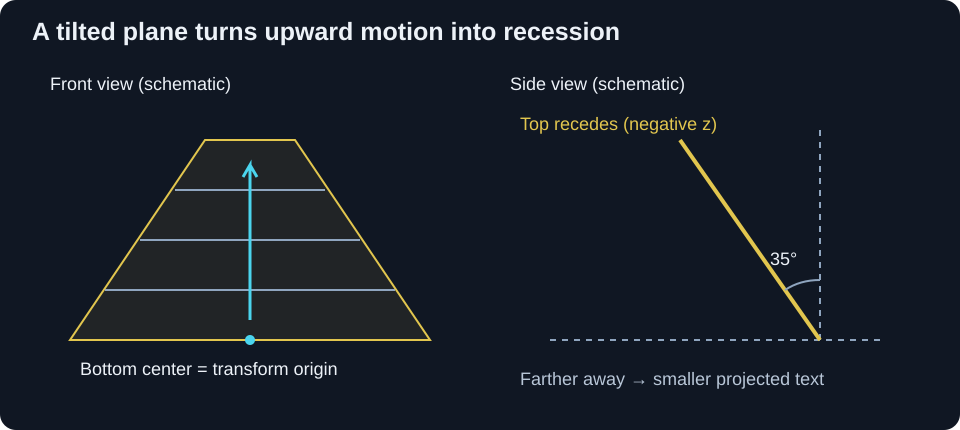
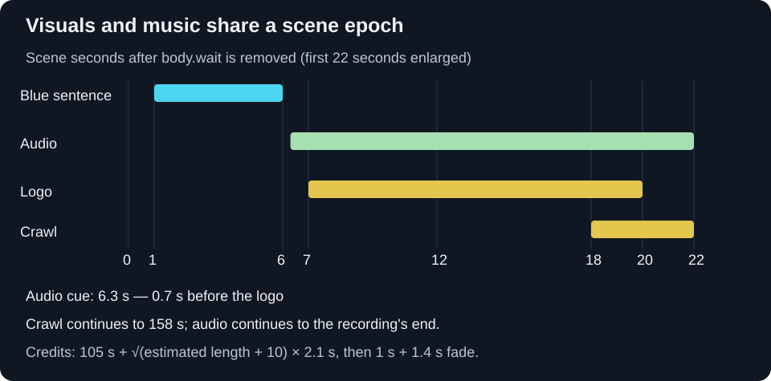

For my web development exam, I presented a complete and accurate recreation of the Star Wars intros, built entirely with HTML5, CSS3, and vanilla JavaScript.
I built the site so users could watch the original intros in both Italian and English, as well as create and edit custom ones through a form.

You can find my complete source code on [GitHub](https://github.com/Richie314/StarWarsIntro "Go to the source code").

> <span class="sr-only">Information: </span>
>
> **A demo is available!**
> 
> Go to <https://starwars.ciucci.dev>
{: .block-info }

In this step-by-step guide, I’ll walk you through how I recreated the intro.

## 1. Give the renderer a small, stable structure

We’ll start with a black page and these layers:

```html
<body class="wait">
  
  <!-- Simple CSS only loader to show until media assets (audio) load -->
  <div id="loader">
    <div class="loader"></div>
  </div>
  
  <!-- Main 16:9 screen -->
  <main id="screen">
    <section class="intro">
      A long time ago in a galaxy far,<br />
      far away...
    </section>
    <section class="logo">
      
    </section>

    <!-- Scrolling content -->
    <article id="board">
      <div id="content">
        <p id="episode">
          Episode X
        </p>
        <p id="title">
          The css awakens
        </p>
        <br />

        <p class="paragraph">
          Text here
        </p>
      </div>
    </article>
    <article id="credits" class="hidden">
      End credits to show the author
    </article>
  </main>
</body>
```

`#screen` is the visible cinema frame.
`.intro` and `.logo` sit above the starfield. 
`#board` supplies the crawl's tilted coordinate system; its child `#content` moves inside that system.
By keeping those two responsibilities on separate elements, we can turn ordinary vertical text movement into movement into depth.

I suggest using three paragraphs to match the audio timing; we’ll see why later.

## 2. Make a responsive cinema frame

We’ll use a 16:9 frame that fits any viewport shape.
Here is the CSS we’ll use to achieve this:

```css
body {
  margin: 0;
  padding: 0;
  width: 100vw;
  height: 100vh;
  overflow: hidden;
  background-color: black;
  min-height: 80px;
}
#screen {
  overflow: hidden;
  aspect-ratio: 16 / 9 !important;
  position: relative;
  width: 100vw;
  height: auto;
  font-size: 1.15vw;
  --percentageOfHeight: calc(100vw / 1600 * 9);
  margin: calc(50vh - 50 * var(--percentageOfHeight)) 0 auto 0;
}
@media screen and (min-aspect-ratio: 16 / 9) {
  #screen {
    width: auto;
    height: 100vh;
    margin: 0 auto;
    font-size: 2.3vh;
    --percentageOfHeight: 1vh;
  }
}
```

When the viewport is narrow or tall, the frame uses the full width.
Its height is `100vw × 9/16`.
The custom property is one hundredth of that frame height: `100vw × 9/1600`.
Therefore `50vh - 50 × var(--percentageOfHeight)` is half the leftover vertical space, centering the frame with black bars above and below.

On a wider viewport, height becomes the limiting dimension.
A full-height 16:9 frame is horizontally centered by the auto margins, with black bars at its sides.
`position: relative` makes the frame the containing block for its absolutely positioned layers.
`overflow: hidden` clips the show to that frame.



## 3. Starfield background

We’ll create the starfield using a series of white `<div>` elements against a black background.

```css
.star {
  position: absolute;
  width: 1.5px;
  height: 1.5px;
  background-color: rgba(249, 251, 242, 0.8);
  z-index: -1;
}
  .star.star-big {
    width: 4px;
    height: 4px;
    border: none;
    border-radius: 2px;
  }
```

Now let's generate 100 of them and put them in random positions.
Each star will have a 6% chance of being slightly larger.

```js
for (let i = 0; i < 100; i++) {
  const star = document.createElement('div');
  star.className = 'star';
  if (Math.random() > 0.94)
    star.classList.add('star-big');

  Object.assign(star.style, {
    top: `${Math.random() * 100}%`, 
    left: `${Math.random() * 100}%`
  });
  document.getElementById('screen').appendChild(star);
}
```

## 4. Blue opening sentence

We’ll place the opening blue text, *A long time ago in a galaxy far, far away...*, in the middle of `#screen` and use a `@keyframes` rule to fade it in and out.

```css
.intro {
  position: absolute;
  top: 40%; 
  left: 15%;
  width: 70%; 
  height: 20%;
  z-index: 1;
  
  font-family: Century Gothic, CenturyGothic, AppleGothic, sans-serif;
  font-size: 2.6em;
  font-weight: 400;
  text-align: left;
  color: rgb(75, 213, 238);
  
  opacity: 0;
  animation: intro 5s ease-out 1s;
}
@keyframes intro {
  0%   { opacity: 0; }
  20%  { opacity: 1; }
  90%  { opacity: 1; }
  100% { opacity: 0; }
}
```

Together with the base `opacity: 0` declaration, these keyframes keep the text hidden before and after the animation. Once we remove the loading class, it will start after a one-second delay and run for five seconds. We’ll raise the opacity to 1 to reveal the text, then lower it back to 0.

## 5. "STAR WARS" logo

I used an SVG image for the logo so the browser can rasterize its vector outlines at the size needed during scaling.
A bitmap at insufficient resolution would look soft at the large initial size.
We’ll use an ordinary `` here: CSS transforms the whole image, rather than animating paths inside the SVG.

```css
.logo {
  position: absolute;
  top: 2.5%;
  left: 2.5%;
  width: 95%;
  height: fit-content;

  z-index: 1;
  overflow: hidden;
  opacity: 0;
  user-select: none;

  animation: logo 13s linear 7s;
  transform-origin: center;
}
  .logo img { 
    width: 100%; 
    height: auto;
  }
@keyframes logo {
  0%   { transform: scale(1.25); opacity: 1; }
  10%  { transform: scale(1.1);  opacity: 1; }
  20%  { transform: scale(.85);  opacity: 1; }
  30%  { transform: scale(.7);   opacity: 1; }
  40%  { transform: scale(.6);   opacity: 1; }
  50%  { transform: scale(.5);   opacity: 1; }
  60%  { transform: scale(.42);  opacity: 1; }
  70%  { transform: scale(.34);  opacity: 1; }
  80%  { transform: scale(.26);  opacity: 1; }
  90%  { transform: scale(.18);  opacity: .8; }
  100% { transform: scale(.1);   opacity: 0; }
}
```

At seven seconds the logo appears already enlarged to 125% of its box.
It shrinks around its center until 20 seconds into the scene.

Opacity stays at one through 80% of the animation (17.4 seconds), then fades toward zero.
`linear` interpolates each segment uniformly, but unequal scale differences between stops mean the overall scale change is not one constant rate.

This is a 2D scale illusion, as the logo does not share the crawl's perspective transform.

## 6. The perspective plane

Now let's add the core geometry:

```css
#board {
  color: #E2C64E;
  font-family: Century Gothic, CenturyGothic, AppleGothic, sans-serif;
  font-weight: bold;
  user-select: none;

  transform: perspective(calc(var(--percentageOfHeight) * 100))
             rotateX(35deg);
  transform-origin: 50% 100%;
  overflow: hidden;
  height: calc(350 * var(--percentageOfHeight));
  width: 95%;
  margin: auto 2.5% 0 2.5%;

  position: absolute;
  bottom: 0; 
  left: 0;
}
```

We’ll call the frame height *H*.
The custom property is `H/100`, so the board is *3.5H tall*, and the perspective distance is *H*.
Its bottom edge is anchored to the frame bottom.
Much of the untransformed board extends above the frame; the transform projects that tall rectangle into a narrowing plane.

`transform-origin: 50% 100%` places the pivot at the bottom center.
`rotateX(35deg)` tilts the top away from the viewer while keeping that pivot in place.
CSS transform composition matters: in `perspective(H) rotateX(35deg)`, the rotation acts on points before the perspective projection. Swapping the functions changes the result.



We can use a simplified calculation to explain the narrowing.
Let’s call a point’s distance upward from the bottom pivot *d*.
Before projection, its coordinates relative to that pivot are approximately:

```text
y = -d × cos(35°)
z = -d × sin(35°)
scale = H / (H - z)
      = H / (H + d × sin(35°))
```

At the pivot, `d = 0`, so the perspective scale is one.
Farther upward, `z` becomes more negative and the denominator grows: the same line of text projects smaller.
This is why parallel edges converge and distant lines become compressed.
These equations describe the transform around the pivot; CSS layout then positions the transformed plane in the frame.

A smaller perspective distance exaggerates the convergence.
A larger distance flattens it.
Increasing the angle lays the board farther back.
I suggest changing one parameter at a time because the angle, board height, and typography jointly determine how much text is visible.

## 7. Main text

We’ll use large text in the board’s local coordinates:

```css
#content {
  position: absolute;
  top: 100%;
  width: 100%;
  color: inherit;
  animation: scroll 140s linear 18s;
}
.paragraph {
  color: inherit;
  font-size: 5.1em;
  word-break: keep-all;
  text-align: justify;
  user-select: none;
}
#episode, #title {
  color: inherit;
  text-align: center;
  font-size: 5.8em;
  overflow-x: visible;
  overflow-y: hidden;
  word-break: keep-all;
}
#title { 
  text-transform: uppercase;
}
@keyframes scroll {
  from { top: 100%; }
  to   { top: -200%; }
}
```

The animation starts at scene time 18 seconds, overlapping the last two seconds of the logo.
Over 140 seconds, `#content` travels from one board-height below the board's top to two board-heights above it.
Percentage `top` values refer to the **board's height**, not the text's height or the viewport.

Since the board is `3.5H`, the total travel is `3 × 3.5H = 10.5H`. The local speed is `10.5H / 140s = 0.075H/s`.
It is linear in the tilted plane, but projected movement becomes slower as the text recedes.
Perspective creates that apparent deceleration without any JavaScript motion loop.

The board clips its children, and the frame clips the whole scene.
At 158 seconds the animation ends. With no forwards fill, `top` returns to its base `100%`, below the visible board.

We’ll justify the paragraphs and center the episode number and title.
The CSS relies on system font fallbacks and browser default paragraph margins and line height; these influence wrapping, spacing, and the eventual credits estimate.

Longer writing does not increase the 140-second scroll duration.
It adds content below the start position, so sufficiently long text can remain unread when the animation ends.

## 8. Initial loader

We’ll add an initial loading *gate* so the CSS animations don’t start before the audio and stylesheets are available.
We’ll give the body the `wait` class initially:

```css
.hidden { 
  display: none !important;
}
#loader { 
  display: none;
}
  body.wait #loader {
    position: absolute;
    width: 100%; 
    height: 100%;
    top: 0; 
    left: 0;

    display: flex;
    justify-content: center;
    align-items: center;

    filter: none;
    z-index: 100;
  }
    body.wait *:not(#loader, .loader) {
      filter: blur(1.5px);
      animation-name: none !important;
      animation-delay: unset !important;
    }
```

This removes animation names while waiting; it does not pause animations halfway through.
Removing `.wait` restores the declarations and starts their delay clocks together.

The loading spinner uses two perpendicular pairs of bars painted with linear gradients.
A `::before` pseudo-element repeats those bars rotated 45 degrees, yielding eight bars.
A conic-gradient mask varies their opacity around the circle.

```css
@keyframes Loader {
  from { transform: rotate(0turn); }
  to   { transform: rotate(1turn); }
}
.loader { 
  animation: Loader 1s steps(8) infinite;
}
```

`steps(8)` advances in eight jumps per second, rather than rotating smoothly.

In the head, we'll load the JavaScript before the stylesheets so their `onload` handlers exist:

```html
<script src="view.js" data-audio-url="intro.mp3"></script>
<link rel="stylesheet" href="view.css" onload="PageStyleLoaded()">
<link rel="stylesheet" href="animations.css" onload="PageAnimationsLoaded()">
```

The JavaScript captures `document.currentScript.dataset.audioUrl` during script execution.
The application then injects the correct asset URL there.

```js
var audioLoaded = false;
var pageStyleLoaded = false;
var pageAnimationsLoaded = false;

function CheckLoad() {
  if (document.readyState === 'loading' || !audioLoaded || !pageStyleLoaded || !pageAnimationsLoaded) 
      return;
  StartPage();
}
function AudioLoaded() { 
  audioLoaded = true; 
  CheckLoad();
}
function PageStyleLoaded() { 
  pageStyleLoaded = true; 
  CheckLoad();
}
function PageAnimationsLoaded() { 
  pageAnimationsLoaded = true; 
  CheckLoad();
}

document.addEventListener('DOMContentLoaded', CheckLoad);
audio.addEventListener('loadeddata', () => AudioLoaded());
```

The `audio` object is created in the next step, before these listeners are registered.
We should keep in mind that the `loadeddata` event means media data has become available; it does not guarantee that the entire track has downloaded or that playback will never stall.

`StartPage()` records the scene epoch and removes `.wait`:

```js
const Now = () => performance.now();
var start = 0;
function StartPage() {
  start = Now();
  document.body.classList.remove('wait');
  StartAudio();
}
```

`performance.now()` gives elapsed milliseconds from a monotonic clock, avoiding wall-clock adjustments.
CSS becomes active on rendering updates, so this is a practical shared epoch, not a guarantee of sample-accurate synchronization.

## 9. Music and timing



Here are the timing values we’ll use:

| Event | Time after releasing `.wait` |
| --- | --- |
| Blue sentence starts / ends | 1 s / 6 s |
| Audio file starts at offset zero | 6.3 s |
| Logo starts / ends | 7 s / 20 s |
| Crawl starts / ends | 18 s / 158 s |
| Credits scheduling begins | 105 s, then a content-based delay |

The soundtrack starts **700 ms before the logo**, not when the logo appears.

I used this timing in the renderer to match the soundtrack.
All the delays depend on the audio file we use; the values in this article are specific to the file in my demo.

We’ll create the audio object and control when playback starts:

```js
const AUDIO_START_DELAY = 6300;
function CreateAudio() {
  const audio = new Audio(audioSource);
  audio.autoplay = false;
  audio.muted = false;
  audio.preload = 'auto';
  return audio;
}
const audio = CreateAudio();
```

We’d like to start the audio once it has loaded, but browser autoplay policies may require the user to interact with the page first. We’ll use a click handler to retry playback and seek to the appropriate position so the audio matches the ongoing animations.

```js
function StartAudio() {
  if (!audio.paused) 
    return;
  
  const deltaT = Now() - start - AUDIO_START_DELAY;
  if (deltaT < 0) {
    setTimeout(StartAudio, -deltaT);
    return;
  }
  if (deltaT >= audio.duration * 1000) 
    return;
  audio.currentTime = deltaT / 1000;
  audio.play().then(
    () => console.log('Audio started')
  ).catch(
    () => console.warn('Audio will start when the user clicks on the page')
  );
}
document.addEventListener('click', () => StartAudio());
```

We’ll handle three cases:

1. **Too early:** a negative `deltaT` schedules another attempt at the cue. A timeout may run late, so the next call recomputes the offset.
2. **On time or late:** seek the track to the position it should have reached, then attempt playback. `currentTime` uses seconds; `performance.now()` and the delay use milliseconds, hence the division by 1000.
3. **Past the end:** leave the finished track silent, rather than restarting it.

For example, a click at scene time 12 seconds requests audio position `12 - 6.3 = 5.7` seconds.
A click at 3 seconds schedules a future attempt; it does not start the music immediately.
Because that later attempt is asynchronous, an early click may still fail to satisfy a browser's autoplay policy.
A click after the cue retries `play()` directly in the click handler.

We’re using a **seek-on-start synchronization** approach.
While audio is already playing, the early return prevents correction.

## 10. Closing credits

We’ll wait 105 seconds before scheduling the closing credits, then add a delay based on the text length.

```js
const CREDITS_SHOW_DELAY = 105 * 1000;
// Inside StartPage():
setTimeout(() => {
  const additional_delay = Math.sqrt(ContentLength() + 10) * 2100;
  if (!isNaN(additional_delay) && additional_delay > 0) {
    setTimeout(show_credits, additional_delay);
  } else {
    show_credits();
  }
}, CREDITS_SHOW_DELAY);
```

`ContentLength()` reads `#content.getBoundingClientRect().height`, temporarily appends a `.paragraph` containing `A`, measures its height, removes it, and rounds the ratio.
It returns zero for `NaN` or negative estimates.

This is an approximate measure, not a count of rendered text lines.
The content includes headings, margins, and spacing, and `getBoundingClientRect()` reflects transformed geometry.
The temporary paragraph can also be at a different depth from the content it is meant to measure.
I use the square-root formula as a **heuristic**; it is not derived from the scroll speed.

For a returned estimate of 30, the extra wait is `sqrt(40) × 2.1 ≈ 13.28` seconds, putting the reveal at about 118.28 seconds. Even an estimate of zero adds `sqrt(10) × 2.1 ≈ 6.64` seconds.

The reveal itself removes `display: none`, permits text selection, waits one more second, and starts a CSS opacity transition:

```js
function show_credits() {
  credits.classList.remove('hidden');
  credits.style.userSelect = 'text';
  setTimeout(() => credits.style.opacity = 1, 1000);
}
```

```css
#credits {
  position: absolute;
  z-index: 50;
  opacity: 0;
  transition: opacity 1.4s ease-in;
}
```

We’ll leave a one-second gap so the browser can render the credits in a transparent state before the opacity changes.

## 11. Keep the presentation unobtrusive

Finally, we’ll use JavaScript to suppress the context menu and hide the pointer after inactivity.
We’ll hide the pointer with a `.no-cursor` class. Whenever the mouse moves, we’ll remove that class, clear the previous timeout, and schedule a new one to hide the pointer after two seconds.
We’ll also set an initial timer to hide it after three seconds if the mouse never moves:

```css
.no-cursor { 
  cursor: none;
}
```
